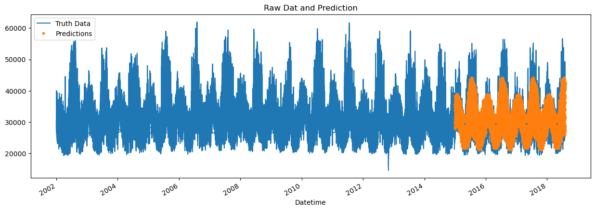
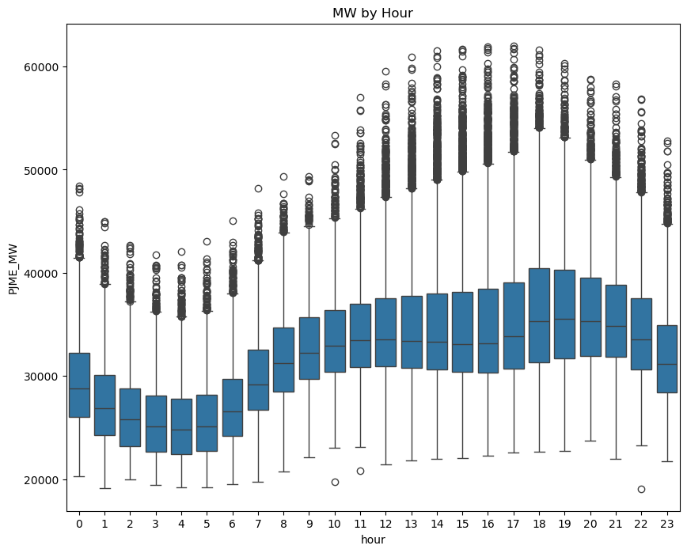
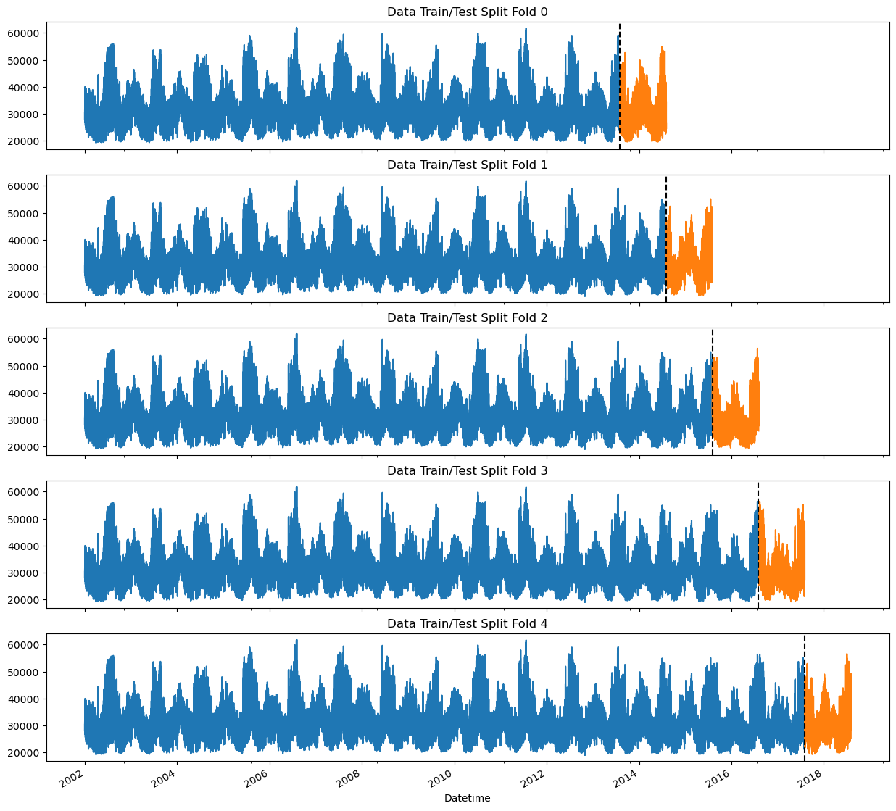

# ⚡ Energy Demand Forecasting with XGBoost

> Forecasting hourly electricity demand for the PJM East grid a full year ahead, trained on 16 years of data and validated without leaking the future into the past.



<sub>Blue: actual hourly demand 2002 to 2018. Orange: model predictions on the 2015 to 2018 test period.</sub>

---

## 💡 Why this matters

Grid operators must decide how much power to generate before demand shows up. Over-forecast and money is wasted on idle capacity. Under-forecast and you risk shortages. Accurate long-range load forecasts drive capacity planning, pricing and maintenance scheduling.

## 📊 Results

| Metric | Value |
|---|---|
| Dataset | **145,366 hourly readings**, Dec 2002 to Aug 2018 |
| Validation | **5-fold time-series CV**, each fold forecasting a full year with a 24-hour gap |
| Mean RMSE across folds | **3,747 MW** |
| Relative error | **≈ 11.7%** of average load (32,082 MW) |
| Fold RMSEs | 3,754 · 3,425 · 3,473 · 4,084 · 3,999 MW |

The model captures the daily cycle, weekday/weekend differences and the summer and winter peaks. A final model trained on all data produces a forecast for **Aug 2018 to Aug 2019**.

## 🔍 What the data shows

Demand follows a strong daily rhythm: lowest around 4 AM, peaking in the early evening. Features that capture time of day and season therefore carry most of the signal.



## 🔧 How it works

1. **Cleaning**: identified and removed physically implausible readings below 19,000 MW (sensor or outage artifacts) after inspecting the distribution.
2. **Feature engineering**
   - Calendar features: hour, day of week, day of month, day of year, week of year, month, quarter, year
   - **Yearly lag features**: demand at the same hour 1, 2 and 3 years earlier (364/728/1,092 days, so weekdays stay aligned)
3. **Leak-free validation**: `TimeSeriesSplit` with 5 one-year test windows and a 24-hour gap, so the model is always tested on data strictly after what it trained on.

   

4. **Model**: XGBoost regressor (depth 3, learning rate 0.01, up to 1,000 trees with early stopping).
5. **Interpretability**: feature-importance analysis to see which drivers matter most.
6. **Forecasting the future**: builds a year of future timestamps, computes features and lags, and predicts.

## 🚀 Quick start

```bash
pip install pandas numpy matplotlib seaborn scikit-learn xgboost
jupyter notebook "Code Implementation.ipynb"
```

The dataset `PJME_hourly.csv` is included in the repo. Point the `pd.read_csv(...)` call in the second cell at it.

## 🧰 Tech stack

Python · pandas · NumPy · XGBoost · scikit-learn · Matplotlib · Seaborn · Jupyter

## 🔭 What I'd do next

- Add weather (temperature) and holiday features, the biggest known drivers of load
- Add SHAP analysis for per-prediction explanations
- Tune hyperparameters with Optuna across the CV folds
- Compare against Prophet and an LSTM baseline
- Package the pipeline as a reusable module with tests

---

<sub>Built by [Shweta Smriti Tripathi](https://www.linkedin.com/in/shweta-smriti-tripathi/) · data: PJM Interconnection hourly load (PJME)</sub>
